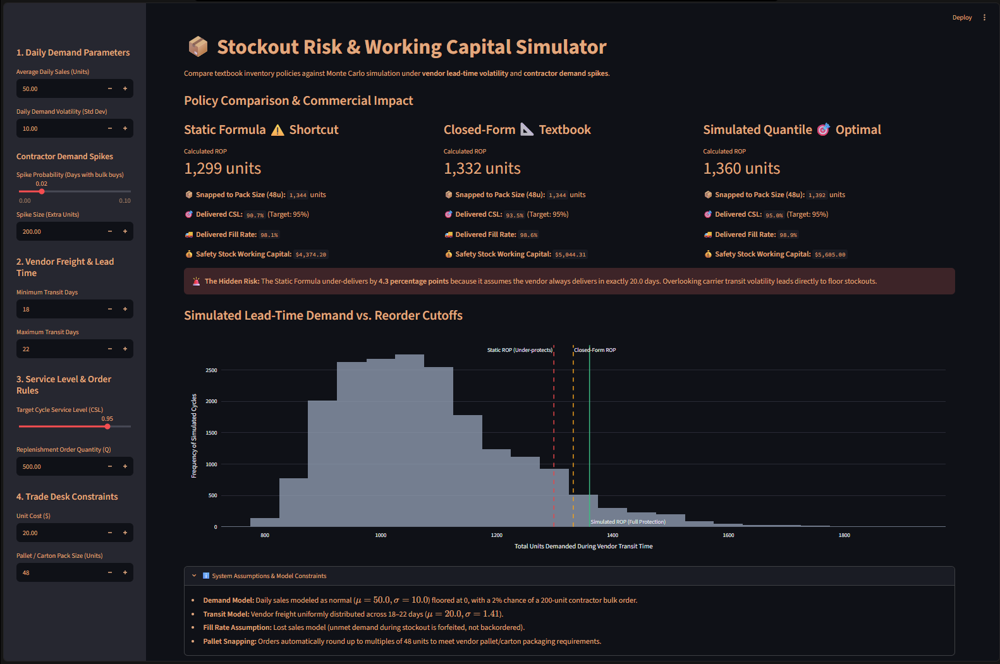

Here's a revised version that reads more naturally, keeping all the technical content intact:

---

# 📦 Inventory Replenishment & Stockout Risk Simulator

A small inventory policy engine with an interactive dashboard for setting reorder points and safety stock when supplier lead times are unpredictable. It compares three approaches side by side, including carrier delays and contractor demand spikes, so you can see how much protection each one actually delivers.

Built with Python, NumPy, Plotly, and Streamlit, and checked with a 20-test `pytest` suite.

---

## 🖥️ Dashboard Preview



---

## 🎯 The Problem

Most reorder formulas assume a supplier's freight always shows up in the same number of days. In practice, on a building materials trade desk, transit times swing around quite a bit. Carriers run late, flatbeds get scarce, and regional bottlenecks pile up.

Ignoring that variability leaves you exposed. Take a vendor whose deliveries land anywhere from 18 to 22 days out. If you use the standard textbook formula to target a 95% cycle service level, you actually end up with roughly 90.7%. That means you run out of stock about one replenishment cycle in ten, not one in twenty.

The engine addresses this by calculating safety stock two ways: with closed-form variance math and with a Monte Carlo simulation of 100,000 replenishment cycles. It then rounds recommendations to the vendor's case or pallet multiples and shows how much working capital the buffer ties up.

---

## 🔬 What It Does

- **Three policies, side by side:**
  1. **Static shortcut:** the baseline formula, which ignores transit variability.
  2. **Closed-form normal approximation:** accounts for lead-time variance (σ_L).
  3. **Monte Carlo simulation (100,000 cycles):** pulls empirical quantiles, so it holds up when lead times are skewed or contractor bulk orders spike unpredictably.
- **Trade-desk constraints:**
  - Shows the exact working capital committed to safety stock.
  - Snaps order quantities to vendor case or pallet sizes (for example, 48 units per pallet).
- **Interactive charts:** a live Plotly view of lead-time demand, with stockout cutoffs marked as you adjust inputs.

---

## 🧪 Verification

The core math lives in `replenishment.py` and is covered by `test_formulas.py`, which has 20 tests. They check that:

- The closed-form results reduce exactly to textbook formulas when lead-time variance is zero.
- Fill rates match the standard normal loss function, G(z) = φ(z) − z(1 − Φ(z)).
- Monte Carlo estimates stay within ±0.005 of the analytical values across several independent seeds.

To run the tests locally:

```bash
pytest -v
```
🚀 Quickstart: Running the Dashboard Locally
code Bash

# 1. Clone repository
git clone https://github.com/elliot-sandburg/stockout-risk-simulator.git
cd stockout-risk-simulator

# 2. Set up virtual environment and install dependencies
python -m venv venv
venv\Scripts\activate
pip install -r requirements.txt

# 3. Launch interactive application
streamlit run app.py