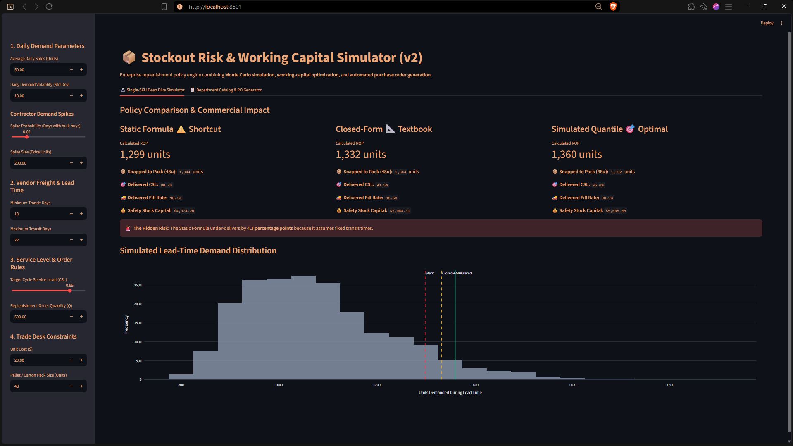
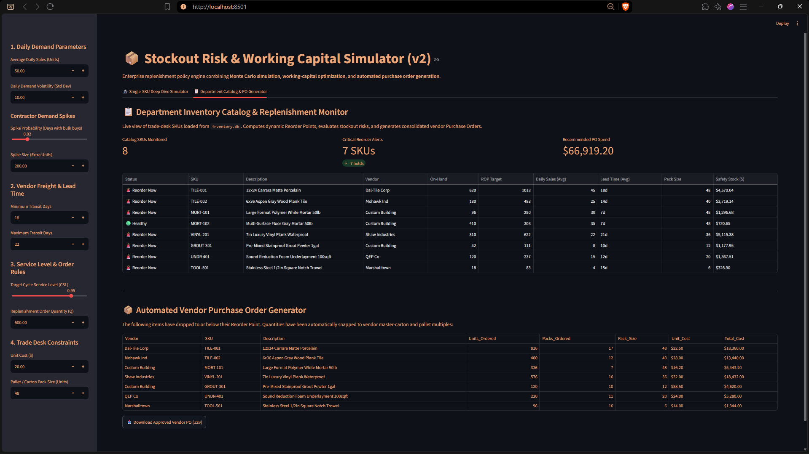

# 📦 Stockout Risk & Working Capital Simulator (v2)

A replenishment tool for teams that need to balance stockout risk against the cash tied up in inventory. It pairs a Monte Carlo simulator with a small SQLite-backed catalog and a purchase order generator, so you can go from "what should our safety stock be?" to an actual order in one place.

Built with Python, SQLite, NumPy, Plotly, and Streamlit, and checked by a 20-test `pytest` suite.

---

## 🖥️ Application Preview

### 🔬 Tab 1: Single-SKU Monte Carlo Simulator & Distribution Engine


### 📋 Tab 2: Department Catalog & Automated PO Generator (v2)


---

## 🎯 The Problem

Most reorder formulas assume a vendor's freight arrives on the same day every time. On a building materials trade desk, that's rarely true. Carriers run short, flatbeds get scarce, and regional bottlenecks stack up, so transit times move around a lot.

Ignoring that variability leaves you exposed. Take a vendor whose deliveries land anywhere from 18 to 22 days out. If you size safety stock with the standard textbook formula aiming for a 95% cycle service level, you actually get about 90.7%. That's roughly one short replenishment cycle in ten, not one in twenty.

The engine sizes safety stock two ways: closed-form variance math and a Monte Carlo simulation of 100,000 cycles. It then rounds the results to the vendor's carton or pallet multiples and shows how much working capital the buffer ties up.

---

## 🔬 What It Does

### Tab 1: Single-SKU Simulator
- **Three policies side by side:** the static shortcut, a closed-form normal approximation, and Monte Carlo empirical quantiles.
- **Demand spike stress tests:** simulates contractor bulk buyouts to see whether the buffer holds.
- **Interactive charts:** a live Plotly view of lead-time demand, with stockout cutoffs marked as you change inputs.

### Tab 2: Department Catalog & PO Generator
- **SQLite catalog (`inventory.db`):** stores SKU master data, unit costs, sales velocity, and vendor lead-time variance.
- **Stockout status flags:** each SKU is marked 🚨 Reorder Now, ⚠️ Warning, or 🟢 Healthy.
- **Purchase orders:** deficits are rounded up to full cartons and pallets, department spend is totaled, and the result exports to CSV in one click.

---

## 🧪 Verification

The math lives in `replenishment.py` and is covered by `test_formulas.py`. The tests confirm that:

- The closed-form results reduce to the textbook formulas when lead-time variance is zero.
- Fill rates match the standard normal loss function, G(z) = φ(z) − z(1 − Φ(z)).
- Monte Carlo estimates stay within ±0.005 of the analytical values across several independent seeds.

To run them locally:

```bash
pytest -v
```

---

## 🚀 Quickstart

```bash
# 1. Clone the repository
git clone https://github.com/elliot-sandburg/stockout-risk-simulator.git
cd stockout-risk-simulator

# 2. Create a virtual environment and install dependencies
python -m venv venv
venv\Scripts\activate
pip install -r requirements.txt

# 3. Seed the database and launch the dashboard
python init_db.py
streamlit run app.py
```